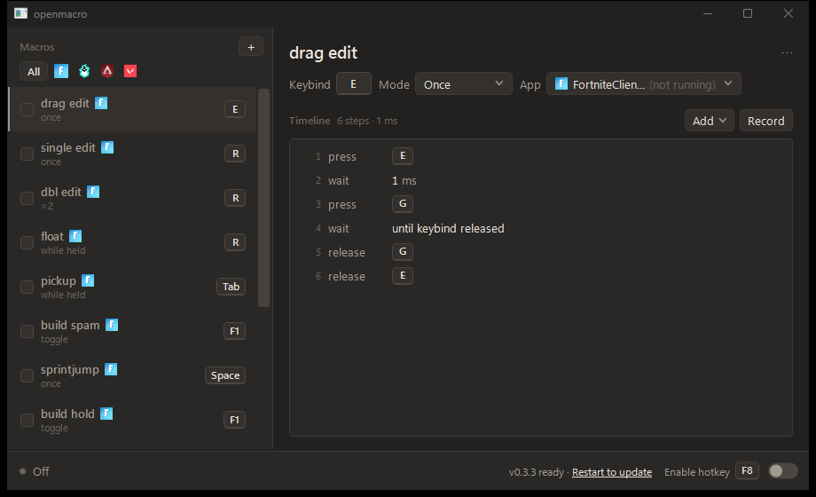
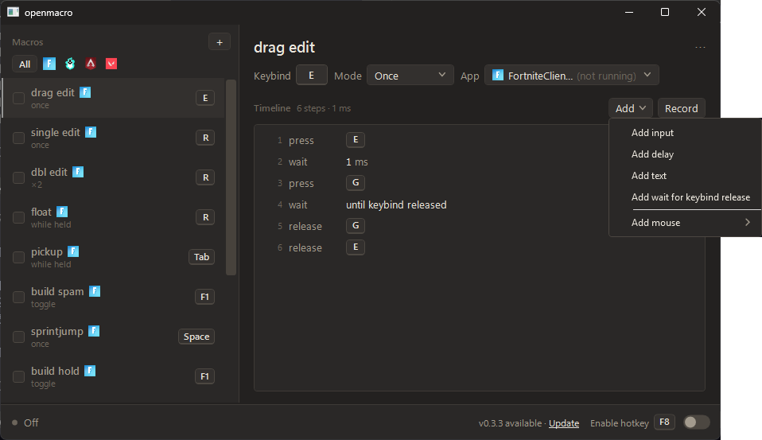

# openmacro



Light, highly customizable macro software for Windows with true 1 ms delays.

**[Download](https://github.com/as9pa/openmacro/releases/latest)** (Windows x64)

## What it does

- **True 1 ms delays:** each step waits for an absolute deadline, so timing never drifts.
- **Recording:** record your keystrokes into a macro, or add steps by hand on a timeline.
- **Play modes:** run once, toggle on and off, play while held, or repeat a set number of times.
- **Keybinds:** bind each macro to a key, plus a global enable hotkey that works from the tray.
- **Per-app limit:** restrict a macro to one app, so the key types normally everywhere else.
- **Light on the system:** runs on its own thread and allocates nothing per cycle.
- **Saved for you:** macros are kept in `%APPDATA%\openmacro\bindings.json`.



## Download

Requires Windows x64.

| [Releases](https://github.com/as9pa/openmacro/releases) | Size    | Needs .NET?                                                                       |
| ------------------------------------------------------- | ------- | --------------------------------------------------------------------------------- |
| `openmacro-v0.3.3-win-x64.exe`                          | ~72 MB  | No, the runtime is inside                                                         |
| `openmacro-v0.3.3-win-x64-dotnet.zip`                   | ~510 KB | Yes, [.NET 10 Desktop Runtime](https://dotnet.microsoft.com/en-us/download)       |

Take the `.exe` unless you already have .NET installed. Windows may warn on first run because the
exe is unsigned: choose "More info", then "Run anyway".

## How the 1 ms delays work

Each delay waits until an absolute deadline instead of sleeping for a duration, so nothing drifts.
The engine runs on its own thread and allocates nothing per cycle, so it stays quiet in the
background and never stutters mid-game.

```csharp
using var _ = TimerResolution.Request(1);        // timeBeginPeriod(1) while firing

var next = Stopwatch.GetTimestamp();
foreach (var step in macro)
{
    next += step.DelayMs * Stopwatch.Frequency / 1000;   // advance the target, never "now"
    while (Stopwatch.GetTimestamp() < next)
        Thread.SpinWait(1);                              // spin the last stretch
    sink.Send(step);
}
```

## Build

Needs the .NET 10 SDK.

    dotnet build OpenMacro.slnx
    dotnet test
    dotnet run --project src\OpenMacro.App

Release builds are made by `.github/workflows/release.yml` when a `v*` tag is pushed (the tag must
match `<Version>` in the csproj). Locally: `dotnet publish src\OpenMacro.App -c Release -p:PublishProfile=SingleFile`
for the `.exe` and `-p:PublishProfile=FrameworkDependent` for the `-dotnet.zip`. Each release also
carries a `SHA256SUMS`.

## License

MIT. See [LICENSE](LICENSE).
